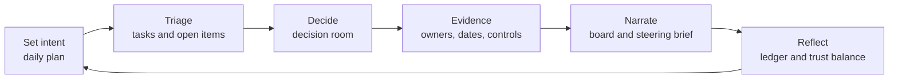
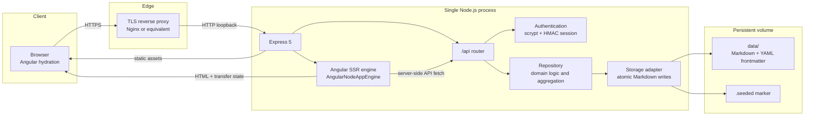
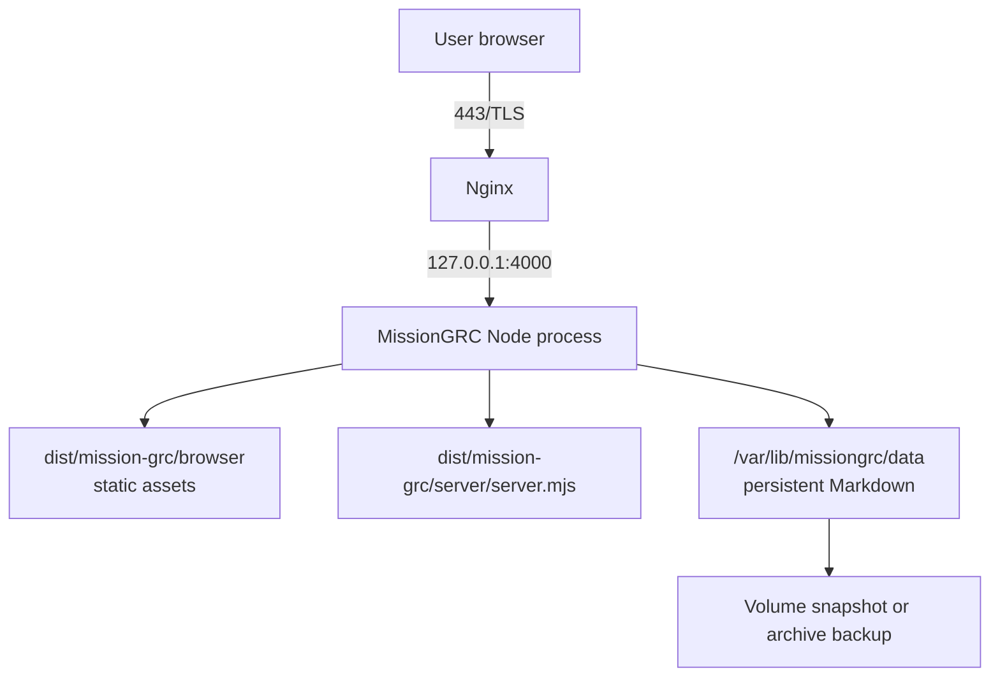
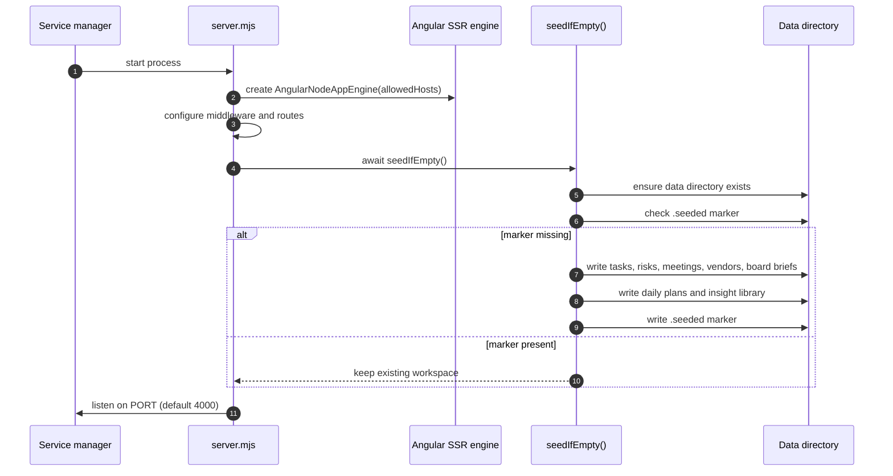
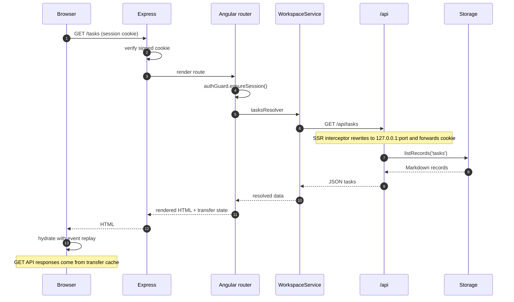
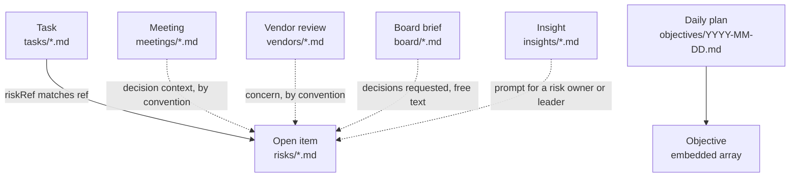
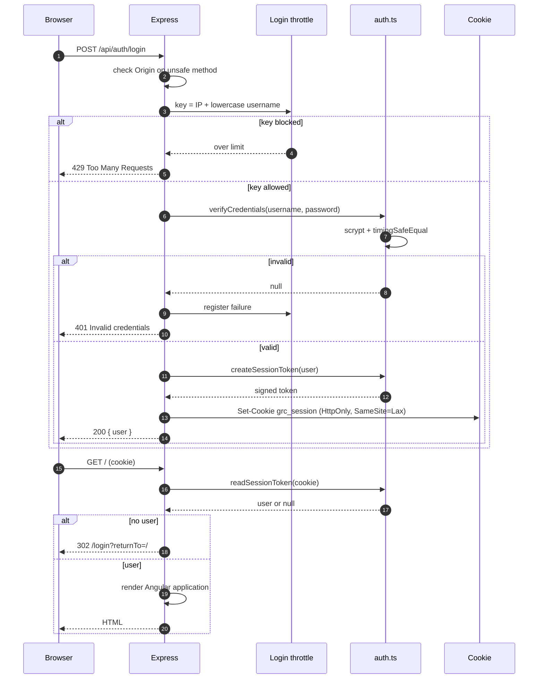
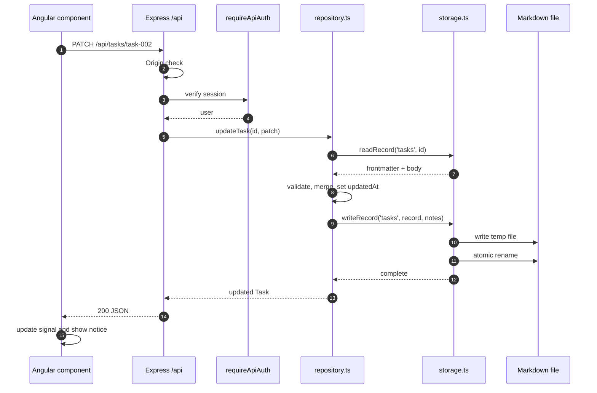

# MissionGRC — Architecture & Implementation Specification

| Field | Value |
| --- | --- |
| Document type | Technical specification sheet |
| Application | MissionGRC (working skeleton) |
| Version | 1.0 |
| Last updated | 6 November 2026 |
| Stack | Angular 20.3 · Angular SSR · Express 5 · Tabler 1.7 · Markdown/YAML |
| Intended deployment | Single Node.js instance behind a TLS reverse proxy |
| Companion document | [pitch.md](./pitch.md) |

> MissionGRC is a daily operating workspace for governance, risk, and compliance work.
> It is deliberately **not** a compliance system of record, an automated assurance tool,
> or a multi-tenant SaaS platform. This document describes what is implemented, how it
> behaves, and where the boundaries are.

## Contents

- [1. Product summary](#1-product-summary)
- [2. Goals, constraints, and non-goals](#2-goals-constraints-and-non-goals)
- [3. Personas and operating loop](#3-personas-and-operating-loop)
- [4. Design principles](#4-design-principles)
- [5. System architecture](#5-system-architecture)
- [6. Technology stack](#6-technology-stack)
- [7. Frontend architecture](#7-frontend-architecture)
- [8. Backend architecture](#8-backend-architecture)
- [9. Data model](#9-data-model)
- [10. Authentication, authorization, and security](#10-authentication-authorization-and-security)
- [11. Request flows](#11-request-flows)
- [12. SEO and SSR behavior](#12-seo-and-ssr-behavior)
- [13. Deployment and operations](#13-deployment-and-operations)
- [14. Quality and verification](#14-quality-and-verification)
- [15. Risks and technical debt](#15-risks-and-technical-debt)
- [16. Roadmap](#16-roadmap)
- [17. File map](#17-file-map)
- [18. Glossary](#18-glossary)

---

## 1. Product summary

MissionGRC gives a GRC specialist one place to answer the questions that shape a working day:

- What decisions need to be made today?
- Which open items are owned, dated, and evidenced?
- What is happening in the decision room?
- Which third parties need attention before renewal?
- What does leadership need to know, and what are we asking them to decide?
- Did the day's work actually move anything forward?

The application combines a server-rendered Angular frontend with a small Express API and a
file-based Markdown repository. Every task, risk, meeting, daily plan, vendor review, board
brief, and reusable quote or question is stored as a human-readable file under `data/`.

The design stance is evidence-first:

1. A risk is not managed until it has an owner, a date, and a traceable rationale.
2. A score is only useful if its inputs are visible.
3. A board narrative is only credible if it is built from the same records as daily work.
4. A workspace is only trustworthy if its data can be read, reviewed, and taken elsewhere.

### 1.1 What this implementation is

- A working skeleton for local use and structured pilots.
- A server-rendered Angular application with hydration and a JSON API.
- A Markdown-native workspace with atomic file writes and deterministic aggregation.
- A calm, opinionated UI built on Tabler with a custom paper-and-forest design layer.
- A demonstration of how daily GRC execution and executive narrative can share one source.

### 1.2 What this implementation is not

| Not this | Why it matters |
| --- | --- |
| A replacement for Archer, ServiceNow, OneTrust, or similar platforms | Those systems own enterprise workflow, control libraries, and regulatory record-keeping. MissionGRC is the daily operating layer above that work. |
| A multi-tenant product | There is one workspace, one data directory, and no tenant isolation. |
| An automated control-monitoring system | Evidence coverage is computed from documented risk records, not from live control tests. |
| An audit opinion or certification | The trust balance is a directional workspace signal, not assurance. |
| A document management system | Board bodies and notes are Markdown; there is no version history, approval workflow, or retention engine. |
| An AI product | All calculations and rankings are deterministic and inspectable. |
| A static site | Authentication, SSR, and writable storage require a Node.js runtime. |

---

## 2. Goals, constraints, and non-goals

### 2.1 Goals

| Goal | Implementation choice | Trade-off accepted |
| --- | --- | --- |
| Make daily decisions visible | Dashboard, decision-room calendar, open items, daily intent | Not a full workflow engine |
| Keep evidence close to the work | `framework` and `control` fields on risk records; evidence coverage metric | Presence of fields is not proof of control effectiveness |
| Give leadership a usable narrative | Board room with Markdown bodies and explicit decisions requested | No slide generation or approval workflow |
| Keep data portable | Markdown + YAML frontmatter on disk | No relational querying or transactional multi-record writes |
| Render fast, indexable public entry | Angular SSR with hydration and HTTP transfer cache | Every private page is rendered per request; no CDN page cache |
| Stay operationally small | One Node process, no database, no message queue | One writable instance only |
| Look calm rather than crowded | Tabler primitives plus a custom editorial design layer | More bespoke CSS than a stock Tabler admin theme |

### 2.2 Constraints

- The app must run as a single Node.js process with a persistent writable directory.
- The data directory may live outside the build output via `GRC_DATA_DIR`.
- Authentication is cookie-based; API calls are same-origin.
- The application assumes HTTPS termination at a reverse proxy in production.
- File writes are atomic per record, but not transactional across records.
- The current UI has no pagination; each list request scans its collection directory.
- Both demo accounts share the same workspace and permissions.

### 2.3 Non-goals for this skeleton

- Role-based access control, SSO, MFA, or user administration.
- Immutable audit logging or e-signature.
- Vendor-facing portals or questionnaire automation.
- Evidence file uploads and document storage.
- Notifications, email, chat, or calendar synchronization.
- Regulatory reporting packs or jurisdiction-specific templates.
- Horizontal scaling or multi-instance coordination.

---

## 3. Personas and operating loop

### 3.1 Personas

| Persona | Representative account | Primary job | What the workspace gives them |
| --- | --- | --- | --- |
| GRC specialist | `ki` — Ki, GRC Specialist | Triage the day, chase evidence, prepare decisions, keep reviews moving | Tasks, daily objectives, open-item ownership, vendor review progress, reusable prompts |
| GRC lead | `admin` — Alex Morgan, GRC Lead | Keep the portfolio coherent and the executive narrative honest | Portfolio view, trust balance, board briefs, decision requests, consistency ledger |
| Risk owner | Not a login persona | Own a risk, issue, decision, or action | Clear owner, due date, exposure, and a question that tests the control |
| Executive or board member | Not a login persona | Decide, sponsor, or challenge | A concise brief with the decision requested and the business exposure |

The current authentication model authenticates people, not roles. The two demonstration
accounts receive the same data and the same permissions.

### 3.2 Operating loop



The loop is intentionally short. Each surface exists to move work from one step to the next,
not to become a separate destination.

---

## 4. Design principles

1. **Decision first, document second.** Every surface asks what needs to be decided, by whom,
   and by when. Documents support that question.
2. **Evidence over assertion.** Risk records carry framework, control, exposure, owner, and due
   date. The dashboard shows how many open items have both a framework and a control.
3. **One screen, one question.** The dashboard leads with the day's intent and the trust
   balance, then moves through open items, meetings, vendors, board narrative, and execution.
4. **Calm density.** Tabler supplies structure; the custom design layer uses warm paper,
   forest greens, restrained borders, and editorial typography to keep attention on content.
5. **Visible arithmetic.** The trust balance is a weighted formula displayed beside its
   inputs. It is not presented as an audit result.
6. **Portable storage.** A record is a Markdown file with YAML frontmatter. It can be read,
   diffed, backed up, or migrated without the application.
7. **Progressive disclosure.** Complex detail lives behind cards, drawers, and edit states;
   the first view answers the immediate question.
8. **Honest limits.** The interface states that the score is directional, the data is file-based,
   and the workspace is a daily driver rather than a system of record.

---

## 5. System architecture

### 5.1 Context diagram



### 5.2 Process responsibilities

| Component | Responsibility | Does not do |
| --- | --- | --- |
| Express | Security headers, JSON parsing, public endpoints, API mounting, auth gate, static assets, SSR hand-off | Domain logic |
| Angular SSR engine | Renders Angular routes on the server, resolves data, serializes transfer state | Direct file access |
| `/api` router | Authentication, input checks, HTTP status mapping, route dispatch | Persistence decisions |
| Repository | Domain defaults, status transitions, reference generation, sorting, dashboard aggregation, trust score | HTTP concerns |
| Storage adapter | Directory creation, Markdown parsing/serialization, safe file names, atomic writes | Business rules |
| Markdown renderer | Escapes raw HTML, then renders a deliberately small Markdown subset | Full CommonMark support |

### 5.3 Runtime topology

- **One application process.** It serves the API, static browser assets, and SSR HTML.
- **One writable data directory.** Defaults to `<cwd>/data`; override with `GRC_DATA_DIR`.
- **One reverse proxy.** Terminates TLS and forwards requests to the Node process.
- **Static assets** are served from `dist/mission-grc/browser` with a one-year cache lifetime.
- **SSR documents** are sent with `Cache-Control: private, no-store`.
- **No database, queue, cache service, or background worker** is required.



### 5.4 Startup and seeding sequence



Deleting the data directory and restarting the process re-seeds the demonstration workspace.
That is useful for demos and dangerous for real data.

---

## 6. Technology stack

| Layer | Technology | Version | Why it is used | Constraint |
| --- | --- | --- | --- | --- |
| UI framework | Angular | 20.3 | Standalone components, signals, route resolvers, SSR support | Browser bundle is larger than a minimal static app |
| Rendering | Angular SSR | 20.3 | Server-rendered HTML for public entry and first paint | Every private route renders per request |
| Server | Express | 5.1 | Small HTTP surface, static assets, API, SSR hand-off | No built-in clustering or session store |
| UI kit | Tabler Core | 1.7.3 | Accessible primitives, layout utilities, form and table patterns | Custom SCSS layer is required to avoid a generic admin look |
| Icons | Tabler Icons webfont | 3.50 | Consistent icon language | Icon font adds a request; assets are local |
| Typography | Manrope Variable, Fraunces Variable | Fontsource | Calm sans-serif UI and editorial display contrast | Self-hosted font files increase bundle size |
| Markdown parsing | gray-matter | 4.0 | YAML frontmatter plus body extraction | YAML serialization requires `undefined` compaction |
| Dates | date-fns | 4.4 | Calendar math, formatting, week boundaries | Dates are stored as ISO strings, not timezone-aware objects |
| Passwords | Node `crypto.scrypt` | Runtime | Memory-hard password hashing | Hash parameters are fixed in code |
| Sessions | Node `crypto.createHmac` | Runtime | Stateless signed session token | No server-side revocation list |
| Styling | SCSS | Angular build | Tokens, layout, component styles | No CSS framework beyond Tabler |
| Language | TypeScript | 5.9 | Shared domain types across client and server | No runtime schema validator |

### 6.1 Why not a database

A database would add migrations, credentials, backup tooling, and operational surface. For a
single-team daily driver, Markdown files provide:

- direct readability during review;
- Git-based versioning and diffing;
- simple backup and migration;
- no proprietary query layer.

The cost is real: no joins, no transactions, no row-level locking, and no efficient querying at
scale. Section 15 records those limits explicitly.

### 6.2 Why SSR

- The public `/login` page can be indexed with a real title, description, canonical URL, and
  structured data.
- Private pages render their first meaningful view on the server, including resolved data.
- Angular hydration with event replay makes the page interactive without re-fetching GET data.
- Private routes remain `noindex`; SSR is for rendering quality, not public exposure.

---

## 7. Frontend architecture

### 7.1 Bootstrapping

| File | Role |
| --- | --- |
| `src/main.ts` | Browser bootstrap |
| `src/main.server.ts` | Server bootstrap |
| `src/app/app.config.ts` | Router, HTTP client, hydration, title strategy, global error listeners |
| `src/app/app.config.server.ts` | Server rendering with `serverRoutes` |
| `src/app/app.routes.server.ts` | `RenderMode.Server` for every route |
| `src/app/app.ts` | Root component and router outlet |
| `src/app/layout/shell.ts` | Authenticated application shell |
| `src/app/layout/shell.html` | Sidebar, top bar, content outlet, footer |

The browser config uses:

- `provideZoneChangeDetection({ eventCoalescing: true })`
- `provideRouter(...)` with component input binding and scroll restoration
- `provideHttpClient(withFetch(), withInterceptors([apiBaseInterceptor]))`
- `provideClientHydration(withEventReplay(), withHttpTransferCacheOptions({ includePostRequests: false }))`
- `AppTitleStrategy` for titles, meta tags, and canonical URLs

### 7.2 Routing contract

| Path | Page title | Guard | Resolver | Data source | Indexing |
| --- | --- | --- | --- | --- | --- |
| `/login` | Sign in | `publicOnlyGuard` | None | Auth API | `index, follow` |
| `/` | Today | `authGuard` | `dashboardResolver` | `GET /api/dashboard` | `noindex, nofollow` |
| `/tasks` | Tasks | `authGuard` | `tasksResolver` | `GET /api/tasks` | `noindex, nofollow` |
| `/calendar` | Decision room | `authGuard` | `meetingsResolver` | `GET /api/meetings` | `noindex, nofollow` |
| `/objectives` | Daily objectives | `authGuard` | `objectivesResolver` | `GET /api/objectives?date=...` | `noindex, nofollow` |
| `/risks` | Open items | `authGuard` | `risksResolver` | `GET /api/risks` | `noindex, nofollow` |
| `/tprm` | Third-party risk | `authGuard` | `tprmResolver` | `GET /api/vendors` | `noindex, nofollow` |
| `/board` | Board room | `authGuard` | `boardResolver` | `GET /api/board` | `noindex, nofollow` |
| `/insights` | Trust library | `authGuard` | `insightsResolver` | `GET /api/insights` | `noindex, nofollow` |
| `/**` | Redirect to `/` | — | — | — | — |

Feature pages are lazy-loaded. The shell is a single authenticated layout; the login page is
outside the shell so it can render as a public entry point.

### 7.3 Data loading and hydration



Key details:

- `apiBaseInterceptor` keeps relative `/api/` URLs in the browser.
- During SSR, it rewrites the request to `http://127.0.0.1:<port>/api/...`.
- The port is inferred from the incoming `Host` header; when absent, it defaults to `4000`.
- The incoming cookie and `Accept-Language` header are forwarded to the internal API call.
- `withHttpTransferCacheOptions({ includePostRequests: false })` caches GET responses for
  hydration but never caches mutations.
- `authGuard` checks `/api/auth/me`; on failure it returns a URL tree to `/login` with
  `returnTo`. The server-side gate also redirects direct document requests before SSR.

### 7.4 State and component structure

The frontend uses Angular signals and route-resolved data rather than a global store.

| Area | Components | Responsibility |
| --- | --- | --- |
| Shell | `ShellComponent` | Navigation, user menu, mobile drawer, logout |
| Dashboard | `DashboardPage` | Daily intent, trust balance, pulse metrics, open items, meetings, vendors, board card, ledger, focus tasks |
| Tasks | `TasksPage` | Flow columns, filters, search, create task, status changes |
| Calendar | `CalendarPage` | Month view, selected day, meeting creation and removal |
| Objectives | `ObjectivesPage` | Intent, objective add/toggle/delete, consistency history |
| Risks | `RisksPage` | Open-item register, severity, owner, status, create item |
| TPRM | `TprmPage` | Tier/status filters, review priorities, progress and status updates |
| Board | `BoardPage` | Brief shelf, requested decisions, Markdown editor, status update |
| Insights | `InsightsPage` | Quote and question library by category and audience |
| Shared | `MetricCard`, `ProgressRing`, `StatusBadge`, `InsightCard`, `EmptyState` | Consistent small surfaces |

Client mutations update local signals after a successful API response. They do not optimistically
assume success, and they surface a toast on failure. This keeps the visible state aligned with
what was actually written to disk.

### 7.5 Design system

The visual language is implemented in `src/styles.scss` and component SCSS:

| Token | Value | Use |
| --- | --- | --- |
| `--mg-paper` | `#f6f4ee` | Warm page background |
| `--mg-paper-strong` | `#fffefb` | Cards and elevated surfaces |
| `--mg-ink` | `#142f27` | Primary text |
| `--mg-ink-soft` | `#3d544a` | Secondary text |
| `--mg-forest` | `#123a2d` | Hero and brand surfaces |
| `--mg-mint` | `#7bd8b1` | Trust highlights on dark surfaces |
| `--mg-emerald` | `#1f7a5c` | Links and positive emphasis |
| `--mg-amber` | `#b2701f` | Warning and due-soon states |
| `--mg-red` | `#b74d3a` | Critical and overdue states |
| `--mg-radius` | `16px` | Card radius |

Typography:

- **Manrope Variable** for interface and body text.
- **Fraunces Variable** for display headings and editorial emphasis.
- Tabler's base CSS supplies layout, forms, badges, tables, and utility classes.

Responsive behavior:

- Desktop uses a persistent sidebar and a 12-column dashboard grid.
- Smaller screens collapse the sidebar behind a scrim and stack the grid.
- Tables become horizontally scrollable rather than losing columns.
- The login page collapses from a two-panel editorial layout to a single form panel.

### 7.6 Accessibility and interaction

Implemented:

- Semantic landmarks (`aside`, `nav`, `main`, `header`, `footer`).
- Labelled icon buttons and form inputs.
- Visible focus styles from Tabler plus custom focus treatment.
- `aria-label` on navigation, progress ring, and icon-only controls.
- Status text is paired with color, not conveyed by color alone.
- A global `prefers-reduced-motion` rule in `src/styles.scss` reduces animation and transition durations and disables smooth scrolling.
- Empty states explain the next action rather than showing a blank panel.

Not yet implemented:

- Automated accessibility testing.
- Full keyboard trap management for every transient panel.
- Screen-reader regression coverage.
- Localization or right-to-left layouts.

### 7.7 SEO and metadata

`AppTitleStrategy` sets:

- `<title>` as `<route title> · MissionGRC`, or `MissionGRC · Trust is the work`.
- `meta[name=description]` from route data with a sensible fallback.
- `meta[name=robots]` from route data, defaulting to `noindex, nofollow`.
- Open Graph title, description, and type.
- `twitter:card` as `summary`.
- `theme-color` as `#0c1f1a`.
- A canonical link using the document origin and the path without query parameters.

Only `/login` opts into indexing. The login page also injects structured data for a
`WebApplication` with a zero-price offer. Private pages are both auth-gated and `noindex`.

### 7.8 Performance characteristics

| Area | Current behavior | Implication |
| --- | --- | --- |
| Page rendering | SSR for every route | Good first paint; CPU cost per request |
| Hydration | Event replay + GET transfer cache | Avoids duplicate API calls for resolved data |
| Static assets | One-year cache, hashed filenames | Fast repeat visits |
| API data | Full collection read per request | Simple, but O(n) per collection |
| Lists | No pagination | Fine for a small workspace; not for thousands of records |
| Bundle | Angular + Tabler + fonts | Budgeted at 2 MB warning / 3 MB error initial |
| Component styles | Budgeted at 16 kB warning / 24 kB error | Keeps per-component CSS bounded |

---

## 8. Backend architecture

### 8.1 Middleware pipeline

Order matters. The implemented order in `src/server.ts` is:

1. **Trust proxy** — `app.set('trust proxy', 1)` so `req.secure` reflects the proxy's
   `X-Forwarded-Proto`.
2. **Disable `X-Powered-By`**.
3. **Security headers** on every response:
   - `X-Content-Type-Options: nosniff`
   - `X-Frame-Options: DENY`
   - `Referrer-Policy: strict-origin-when-cross-origin`
   - `Permissions-Policy: camera=(), microphone=(), geolocation=()`
4. **JSON body parsing** with a `256kb` limit.
5. **`GET /robots.txt`** — allows crawling, disallows `/api/`.
6. **`GET /sitemap.xml`** — lists `/login` only.
7. **`/api` router**.
8. **`/api` error handler** — logs the error and returns a generic JSON 500.
9. **Static assets** from the browser build, with `index: false` and `redirect: false`.
10. **Document auth gate** — public paths pass; unauthenticated document requests redirect to
    `/login?returnTo=...`.
11. **SSR handler** — sets `Cache-Control: private, no-store`, renders, and writes the response.
12. **Startup** — seed if needed, then listen if this is the main module.

The API is mounted before the static and SSR layers, so API requests never fall through to the
Angular renderer. The `/api` error handler is scoped to the API router.

### 8.2 API surface

All workspace routes below `/api` require a valid session cookie except the login and logout
endpoints. Authentication is applied with `router.use(requireApiAuth)` after the auth routes.

| Method | Path | Auth | Purpose | Success |
| --- | --- | --- | --- | --- |
| `POST` | `/api/auth/login` | Public | Validate credentials, set session cookie | `200 { user }` |
| `POST` | `/api/auth/logout` | Public | Clear session cookie | `200 { ok: true }` |
| `GET` | `/api/auth/me` | Required | Return current user | `200 { user }` |
| `GET` | `/api/session` | Required | Return the authenticated session user | `200 { user }` |
| `GET` | `/api/dashboard` | Required | Aggregated daily workspace | `200 DashboardData` |
| `GET` | `/api/tasks` | Required | List tasks sorted by status, due date, priority | `200 Task[]` |
| `POST` | `/api/tasks` | Required | Create a task | `201 Task` |
| `PATCH` | `/api/tasks/:id` | Required | Update task fields or status | `200 Task` |
| `DELETE` | `/api/tasks/:id` | Required | Delete a task | `200 { ok }` / `404` |
| `GET` | `/api/risks` | Required | List open items | `200 RiskItem[]` |
| `POST` | `/api/risks` | Required | Create a risk, issue, decision, or action | `201 RiskItem` |
| `PATCH` | `/api/risks/:id` | Required | Update status, owner, due date, or notes | `200 RiskItem` |
| `GET` | `/api/meetings?from=&to=` | Required | List meetings, optionally bounded by date | `200 Meeting[]` |
| `POST` | `/api/meetings` | Required | Create a meeting | `201 Meeting` |
| `DELETE` | `/api/meetings/:id` | Required | Delete a meeting | `200 { ok }` / `404` |
| `GET` | `/api/vendors` | Required | List vendors by tier, risk, and review date | `200 Vendor[]` |
| `PATCH` | `/api/vendors/:id` | Required | Update status, progress, review date, notes | `200 Vendor` |
| `GET` | `/api/board` | Required | List board briefs with rendered HTML | `200 BoardBrief[]` |
| `PATCH` | `/api/board/:id` | Required | Update brief metadata, decisions, or body | `200 BoardBrief` |
| `GET` | `/api/objectives?date=YYYY-MM-DD` | Required | Get a daily plan | `200 DailyPlan` |
| `GET` | `/api/objectives/history?days=N` | Required | Get bounded daily completion history | `200 Array` |
| `PATCH` | `/api/objectives/:date/intent` | Required | Set the daily intent | `200 DailyPlan` |
| `POST` | `/api/objectives/:date/objectives` | Required | Add an objective | `201 DailyPlan` |
| `PATCH` | `/api/objectives/:date/objectives/:id` | Required | Update an objective | `200 DailyPlan` |
| `DELETE` | `/api/objectives/:date/objectives/:id` | Required | Remove an objective | `200 DailyPlan` |
| `GET` | `/api/insights` | Required | List quotes and questions | `200 Insight[]` |

Validation is intentionally thin:

- The API checks required titles and dates for creation.
- The repository coerces enums to known values and falls back to defaults.
- Strings are trimmed and length-capped.
- Dates must match `YYYY-MM-DD` for persistence.
- There is no JSON Schema or runtime type validator at the boundary.

### 8.3 Repository responsibilities

`src/server/repository.ts` is the domain boundary. It owns:

- **Defaulting**: priority, status, workstream, framework, control, exposure, owner.
- **Reference generation**: `nextRef(existing, prefix)` produces the next yearly reference.
- **Status transitions**: setting `completedAt` when a task moves to `done`; removing it when a
  task leaves `done`; forcing vendor progress to 100 on `complete`.
- **Sorting**: task flow order, risk severity and due date, vendor tier and risk, meeting time,
  board date.
- **Aggregation**: dashboard pulse, focus tasks, open items, vendor watchlist, next board,
  weekly ledger.
- **Derived values**: evidence coverage, follow-through, weekly objective average, trust balance,
  and consistency streak.
- **Rendering**: board bodies through the safe Markdown renderer.

Reference conventions:

| Record | Pattern | Generated at runtime? |
| --- | --- | --- |
| Task | `TSK-YYYY-NNN` | Yes |
| Risk | `RSK-YYYY-NNN` | Yes |
| Issue | `ISS-YYYY-NNN` | Yes |
| Decision | `DEC-YYYY-NNN` | Yes |
| Action | `ACT-YYYY-NNN` | Yes |
| Vendor | `VND-NNN` | Seeded; not generated by an API |
| Board brief | `BRD-NNN` | Seeded; not generated by an API |

Record IDs are opaque: new tasks, open items, meetings, and objectives use the first eight
characters of a UUID. Seeded records use readable IDs such as `task-001`.

### 8.4 Storage layer

`src/server/storage.ts` is deliberately small:

| Operation | Behavior |
| --- | --- |
| `listRecords(collection)` | Ensures the folder exists, reads every `*.md`, parses frontmatter and body |
| `readRecord(collection, id)` | Reads one file by safe file name, returns `null` if missing |
| `writeRecord(collection, record, body)` | Compacts undefined fields, serializes YAML + body, writes a temp file, renames atomically |
| `deleteRecord(collection, id)` | Removes the file, returns false if absent |
| `ensureDataDirectory()` | Creates the data directory and writes a README if absent |
| `replaceFile(path, contents)` | Writes a temp file and renames, used for the seed marker |
| `renderMarkdown(markdown)` | Escapes HTML first, then renders headings, paragraphs, lists, bold, italic, and inline code |

Important properties:

- **Atomic per file.** Writes go to `.<id>.<pid>.tmp` in the same folder, then `rename`.
- **Safe file names.** IDs are reduced to `[a-zA-Z0-9._-]`; path traversal cannot escape the
  collection folder.
- **Undefined compaction.** `compact()` removes `undefined` values before YAML serialization;
  without it, `js-yaml` would throw on optional frontmatter fields.
- **Body is the note.** For tasks, risks, meetings, and vendors, the Markdown body is the
  `notes` field. For board briefs, the body is the narrative. For insights, the body is the
  quote or question text.
- **No transaction across records.** A dashboard read can observe a partially completed set of
  writes if several records are updated concurrently.

### 8.5 Error handling

- API route handlers are wrapped by `handle()`, which forwards rejected promises to Express.
- The `/api` error middleware logs the error and returns
  `{ "error": "Something went wrong while reading the workspace." }` with status 500.
- Missing records return `404` with a domain-specific message.
- Invalid creation requests return `400`.
- SSR errors are passed to the next Express error handler; there is no custom SSR error page.
- Browser-side mutation failures show a toast rather than silently changing local state.

### 8.6 Concurrency and consistency

The repository reads the directory on each request and writes individual files atomically.
This is sufficient for one user or a small team on a local network, but it is not a
multi-writer database:

- Two simultaneous updates to the same record are last-write-wins.
- A multi-file operation, such as seeding, is not atomic as a whole.
- In-memory login throttling is per process and resets on restart.
- No file locks or version vectors are used.
- Running two application instances against the same directory is unsupported.

---

## 9. Data model

### 9.1 Collections

| Collection | Folder | One file per | File naming | Editable in UI |
| --- | --- | --- | --- | --- |
| Tasks | `data/tasks/` | Task | `task-<id>.md` or seeded `task-NNN.md` | Create, update, delete |
| Open items | `data/risks/` | Risk, issue, decision, or action | `item-<id>.md` or seeded descriptive ID | Create, update |
| Meetings | `data/meetings/` | Meeting | `meeting-<id>.md` or seeded descriptive ID | Create, delete |
| Daily plans | `data/objectives/` | Calendar day | `YYYY-MM-DD.md` | Intent, add/update/delete objectives |
| Vendors | `data/vendors/` | Vendor review | `vendor-<name>.md` | Update status, progress, review date, notes |
| Board briefs | `data/board/` | Brief | `board-<name>.md` | Update metadata, decisions, body |
| Insights | `data/insights/` | Quote or question | `quote-NNN.md`, `question-NNN.md` | Read-only in the UI |
| Data README | `data/README.md` | Workspace | Fixed | Not editable in the UI |
| Seed marker | `data/.seeded` | Workspace | Fixed | Not editable in the UI |

### 9.2 Relationship model



Only `Task.riskRef` is an explicit stored reference. The other dotted relationships are editorial
conventions: a meeting note, vendor concern, board decision, or insight question may mention a
risk reference, but no foreign key is enforced. This is a deliberate simplification and a known
limitation for reporting.

### 9.3 Enumerations

| Type | Values |
| --- | --- |
| `Priority` | `critical`, `high`, `medium`, `low` |
| `TaskStatus` | `todo`, `doing`, `blocked`, `done` |
| `Workstream` | `triage`, `decision`, `evidence`, `tprm`, `board`, `audit`, `relationship` |
| `RiskType` | `risk`, `issue`, `decision`, `action` |
| `RiskStatus` | `open`, `in-progress`, `monitoring`, `closed` |
| `VendorStatus` | `not-started`, `in-review`, `awaiting-vendor`, `complete`, `escalated` |
| `BoardStatus` | `drafting`, `in-review`, `final` |
| `MeetingType` | `decision`, `vendor`, `audit`, `board`, `one-on-one`, `focus` |
| `ObjectiveCategory` | `judgment`, `execution`, `influence`, `evidence`, `relationship` |
| `InsightKind` | `quote`, `question` |

### 9.4 Schemas and examples

#### Task

Fields: `id`, `ref`, `title`, `status`, `priority`, `due`, `owner`, `workstream`,
`riskRef?`, `createdAt`, `updatedAt`, `completedAt?`. The Markdown body is `notes`.

```markdown
---
id: task-002
ref: TSK-2026-002
title: 'Prepare decision brief: CRM migration compensating control'
status: doing
priority: critical
due: '2026-11-06'
owner: Ki
workstream: decision
riskRef: DEC-2026-007
createdAt: '2026-10-27T08:00:00.000Z'
updatedAt: '2026-11-04T16:10:00.000Z'
---
Frame the choice as speed versus evidence. Name the owner, the accepted exposure,
and the exit gate.
```

#### Open item

Fields: `id`, `ref`, `title`, `type`, `status`, `severity`, `owner`, `businessUnit`, `due`,
`framework`, `control`, `exposure`, `decisionNeeded`, `createdAt`, `updatedAt`. The body is
`notes`.

```markdown
---
id: risk-northwind-soc2
ref: RSK-2026-014
title: Northwind Analytics lacks current SOC 2 Type II evidence
type: risk
status: open
severity: high
owner: Priya Nair
businessUnit: Data & Analytics
due: '2026-11-06'
framework: ISO 27001
control: A.5.19 — Supplier security
exposure: $1.4M ARR reporting dependency; renewal on 21 Nov
decisionNeeded: false
createdAt: '2026-10-23T08:00:00.000Z'
updatedAt: '2026-11-03T16:20:00.000Z'
---
Northwind supports 31% of customer reporting. The SOC 2 report expired in September
and the subprocessor list is four months old. Do not renew without evidence.
```

#### Meeting

Fields: `id`, `title`, `date`, `start`, `end`, `type`, `location`, `attendees`, `owner`.
The body is `notes`.

```markdown
---
id: meeting-northwind-review
title: Northwind renewal gate
date: '2026-11-06'
start: '14:00'
end: '14:45'
type: vendor
location: Virtual
attendees:
  - Priya Nair
  - Alex Morgan
owner: Ki
---
Decide whether to renew before the bridge letter arrives. If not, agree the exit path.
```

#### Daily plan

One file per day. Fields: `id` (same as date), `date`, `intent`, `objectives`.
`completion` is derived at read time and is not persisted.

```markdown
---
id: '2026-11-06'
date: '2026-11-06'
intent: Slow down enough to make the decision explicit — then move with conviction.
objectives:
  - id: obj-6f32a1c4
    text: Close the Northwind evidence gap before the renewal call.
    category: evidence
    done: false
  - id: obj-9b18d2e0
    text: Leave the CRM decision with one named owner and an exit gate.
    category: judgment
    done: true
---
```

#### Vendor review

Fields: `id`, `ref`, `vendor`, `service`, `tier`, `riskRating`, `status`, `reviewDue`,
`lastReview`, `owner`, `dataClass`, `progress`, `framework`, `concerns`. The body is `notes`.

```markdown
---
id: vendor-northwind
ref: VND-001
vendor: Northwind Analytics
service: Customer analytics SaaS
tier: 1
riskRating: high
status: in-review
reviewDue: '2026-11-06'
lastReview: '2025-11-06'
owner: Ki
dataClass: Restricted
progress: 55
framework: ISO 27001
concerns:
  - SOC 2 Type II report expired in September
  - Subprocessor list is four months old
  - No 24-hour breach notification clause
---
Supports 31% of customer reporting. Renewal gate on 21 Nov. Require a bridge letter.
```

#### Board brief

Fields: `id`, `ref`, `title`, `date`, `audience`, `status`, `owner`, `decisions`. The body is
the narrative and is rendered to `bodyHtml` by the safe Markdown renderer.

```markdown
---
id: board-q4-pre-read
ref: BRD-001
title: Q4 Board Risk Committee — Executive pre-read
date: '2026-11-18'
audience: Board Risk Committee
status: drafting
owner: Alex Morgan
decisions:
  - Approve a 90-day continuous control monitoring pilot ($85k).
  - >-
    Accept the CRM migration compensating control, with a reviewed exit gate on
    15 January 2027.
---
## Why this matters now

Three critical vendors have evidence or exit-plan gaps. The issue is not the number
of vendors; it is the concentration of business dependency and the absence of a
tested recovery path.

## The decision

Approve the pilot and the compensating control, with named owners and a review date.
```

#### Insight

Fields: `id`, `kind`, `category`, `audience?`, `source?`, `timestamp?`, `attribution?`.
The body is the quote or question text.

```markdown
---
id: question-061
kind: question
category: Ask a risk owner
audience: risk-owner
---
If this control failed tomorrow, how would we know before a customer did?
```

### 9.5 Derived dashboard values

`getDashboard(user)` reads tasks, risks, meetings, vendors, board briefs, the day's plan, and
the insight pair in parallel. It then computes:

| Value | Definition |
| --- | --- |
| `openItems` | Risks with status not equal to `closed` |
| `criticalItems` | Open risks with severity `critical` |
| `overdue` | Open risks past due excluding `monitoring`, plus open tasks past due |
| `openTasks` | Tasks with status not equal to `done` |
| `doneToday` | Tasks completed today |
| `objectivesDone` / `objectivesTotal` | Completion state of the current day's plan |
| `vendorActions` | Vendors escalated, or incomplete with a review due within 14 days |
| `evidenceCoverage` | Open risks with both `framework` and `control`, divided by open risks |
| `trustScore` | Weighted blend of evidence coverage, follow-through, and weekly objective average |
| `streak` | Consecutive days, up to 60, with at least one completed objective or task |

The trust balance formula is:

```text
trustScore = round(
  evidenceCoverage × 0.35 +
  min(followThrough, 100) × 0.35 +
  weeklyObjectiveAverage × 0.30
)
```

Where:

- `evidenceCoverage` is the percentage of open risks with both a framework and a control.
- `followThrough` is tasks completed this week divided by tasks created this week.
- `weeklyObjectiveAverage` is the average daily objective completion across the current week;
  days without objectives count as zero.

The result is clamped to `0..100`. Example: evidence coverage 80, follow-through 60, and weekly
objective average 75 produce `(80×0.35) + (60×0.35) + (75×0.30) = 71.5`, rounded to `72`.

This is a directional operating signal, not an audit opinion. It rewards documentation,
follow-through, and consistency; it does not test whether a control actually works.

Other dashboard selection rules:

- **Focus tasks**: open tasks due within two days or marked critical/high, capped at five.
- **Meetings**: upcoming meetings sorted by date and start time, capped at five.
- **Open items table**: the first six open risks in repository order.
- **Vendor watchlist**: incomplete vendors, capped at five.
- **Next board**: the first brief dated today or later; otherwise the latest brief.
- **Insights**: deterministic daily selection from questions and quotes, with fallbacks when the
  library is empty.

---

## 10. Authentication, authorization, and security

### 10.1 Accounts and password handling

The skeleton ships with two demonstration accounts:

| Username | Name | Role | Password |
| --- | --- | --- | --- |
| `admin` | Alex Morgan | GRC Lead | `Dare2Hack$` |
| `ki` | Ki | GRC Specialist | `Dare2ImpressU` |

Passwords are never stored in plain text. Each account record contains a 16-byte salt and a
64-byte scrypt-derived hash. Verification uses `scryptSync(password, salt, 64)` and
`timingSafeEqual`. Unknown usernames still perform a dummy derivation so the response time does
not trivially reveal whether an account exists.

The demo account cards on the login page expose the account names and roles and fill the form when
selected; passwords are not rendered in the page. The demo passwords remain in client-side source
code and documentation, so they must be rotated or the cards removed before any shared deployment.

### 10.2 Session model

- Cookie name: `grc_session`.
- Payload: `sub`, `name`, `role`, `initials`, `focus`, `iat`, `exp`.
- Encoding: base64url JSON.
- Signature: HMAC-SHA256 with `SESSION_SECRET`, base64url encoded.
- Lifetime: 8 hours.
- Cookie flags: `httpOnly`, `sameSite=lax`, `secure` when `req.secure`, `path=/`.
- Stateless validation: signature, expiry, and account existence are checked on every request.
- No server-side session store or revocation list exists. Rotating `SESSION_SECRET` invalidates
  all sessions at once.

`SESSION_SECRET` falls back to a documented local-development value. That fallback is not safe
for production.

### 10.3 Login flow



Login throttling:

- Window: 10 minutes.
- Limit: 10 failures per `IP:username` key.
- Storage: in-memory `Map`.
- Reset: successful login clears the key; process restart clears all keys.
- Scope: per process, so multiple instances would each have their own counters.

### 10.4 Authorization

Authorization is binary: authenticated or not. Every workspace API route after
`router.use(requireApiAuth)` requires a valid session. There is no per-record ownership check,
no role check, and no read-only account.

Browser navigation is protected twice:

1. **Server gate** redirects unauthenticated document requests to `/login?returnTo=...`.
2. **Angular guard** checks `/api/auth/me` and returns a URL tree to `/login`.

The server gate is important for direct hits and SSR. The client guard is important for
in-app navigation and for returning the user to the requested page after login.

### 10.5 Implemented hardening

| Control | Implementation |
| --- | --- |
| Password hashing | scrypt with per-account salt, constant-time comparison |
| Session integrity | HMAC-SHA256 signature, expiry check, account existence check |
| Session cookie | `HttpOnly`, `SameSite=Lax`, `Secure` when served over HTTPS |
| Login throttling | 10 failures per 10 minutes per IP and username |
| Cross-origin writes | Unsafe methods reject a mismatched `Origin` header |
| Request size | JSON body limited to 256 kB |
| Clickjacking | `X-Frame-Options: DENY` |
| MIME sniffing | `X-Content-Type-Options: nosniff` |
| Referrer leakage | `Referrer-Policy: strict-origin-when-cross-origin` |
| Device permissions | `Permissions-Policy` disables camera, microphone, geolocation |
| Path traversal | Record IDs are sanitized before file access |
| Stored HTML injection | Markdown input is HTML-escaped before rendering |
| Private indexing | Default `noindex, nofollow`; only `/login` is indexable |
| Private caching | SSR documents use `Cache-Control: private, no-store` |
| Powered-by disclosure | `X-Powered-By` disabled |

### 10.6 Known security and production gaps

These are explicit boundaries of the skeleton, not hidden assumptions:

- **No SSO, SAML, OIDC, MFA, or password reset.**
- **No RBAC.** `admin` and `ki` have identical access.
- **No immutable audit log.** `updatedAt` is a timestamp, not an actor-attributed history.
- **No encryption at rest.** File-system permissions and volume encryption are the operator's
  responsibility.
- **No CSRF token.** Protection relies on `SameSite=Lax` plus the `Origin` check. Requests
  without an `Origin` header are not rejected by that check.
- **No Content-Security-Policy header.** A CSP should be added and tested before exposure.
- **No secret rotation procedure** beyond restarting with a new `SESSION_SECRET`.
- **No request rate limiting on workspace APIs**, only on login.
- **No dependency or container image scanning** in the repository.
- **Demo accounts and documented demo passwords** must be removed or rotated for production.
- **No file locking.** Two writers can overwrite each other's changes.
- **No health endpoint.** Use `/login` or the process manager for liveness checks.

Production requires, at minimum:

1. A strong random `SESSION_SECRET` stored outside the repository.
2. Removal or rotation of demo accounts and the demo account cards.
3. TLS termination and `PUBLIC_ORIGIN` configured.
4. A dedicated, least-privilege OS user for the process and data directory.
5. Backups and a tested restore procedure.
6. A written decision about SSO, RBAC, and audit logging before multi-user use.

### 10.7 Public and private indexing

| Surface | Indexable | Notes |
| --- | --- | --- |
| `/login` | Yes | Public entry point; title, description, canonical, structured data |
| All workspace pages | No | `noindex, nofollow` default plus auth gate |
| `/api/*` | No | Disallowed in `robots.txt`; JSON responses |
| `/robots.txt` | Public | Crawl policy |
| `/sitemap.xml` | Public | Contains `/login` only |

The sitemap is generated from `PUBLIC_ORIGIN` when set, otherwise from the request protocol and
Host. It intentionally does not enumerate private pages.

---

## 11. Request flows

### 11.1 Authenticated page render

1. Browser requests `GET /risks` with the session cookie.
2. Express sets security headers and parses the request.
3. Static middleware finds no matching asset.
4. Document auth gate reads and verifies the cookie.
5. If invalid: `302` to `/login?returnTo=%2Frisks`.
6. If valid: SSR handler sets `Cache-Control: private, no-store` and invokes Angular.
7. `authGuard` calls `/api/auth/me`; SSR interceptor rewrites to loopback and forwards the cookie.
8. The route resolver calls `/api/risks`.
9. The API authenticates again, calls `listRisks()`, which lists and parses Markdown.
10. Angular renders the page and serializes transfer state.
11. Browser receives HTML, hydrates, and replays events.
12. The GET response for `/api/risks` is served from the transfer cache during hydration.

### 11.2 Write path



Every mutation follows this shape. The API returns the updated record; the client does not
invent the new state.

### 11.3 Logout

1. Browser calls `POST /api/auth/logout`.
2. Origin is checked on the unsafe request.
3. Express clears `grc_session` with matching path and flags.
4. Client clears its local user signal and session request cache.
5. The next protected navigation is redirected to `/login`.

### 11.4 Static and crawler endpoints

- `GET /robots.txt` returns a text policy allowing all paths except `/api/`.
- `GET /sitemap.xml` returns XML with `/login`.
- `GET /favicon.ico` is treated as public and falls through to static assets or SSR.
- Hashed JS, CSS, and font assets are served with a one-year cache lifetime.

---

## 12. SEO and SSR behavior

| Concern | Implementation |
| --- | --- |
| Rendering mode | `RenderMode.Server` for `**` |
| Public page | `/login` only |
| Private pages | Auth gate plus `noindex, nofollow` |
| Title | Route title plus `· MissionGRC` |
| Description | Route `data.description` with a product fallback |
| Canonical | Origin plus path without query string |
| Open Graph | `og:title`, `og:description`, `og:type` |
| Twitter | `summary` card |
| Structured data | `WebApplication` JSON-LD on the login page |
| Sitemap | `/login` only |
| Robots | Allow all, disallow `/api/` |
| Private caching | `Cache-Control: private, no-store` |
| Static caching | One year, hashed assets |

The canonical URL uses `document.location.origin`, which is correct behind a properly configured
reverse proxy. If the proxy rewrites Host or protocol incorrectly, canonical and sitemap URLs
will be wrong. Set `PUBLIC_ORIGIN` for sitemap generation and ensure `X-Forwarded-Proto` is
forwarded.

There is no Open Graph image, RSS feed, blog, or marketing site in this repository. The public
SEO surface is intentionally limited to the login entry point.

---

## 13. Deployment and operations

### 13.1 Build

```bash
npm ci
npm run build
```

Output:

```text
dist/mission-grc/
├── browser/          # static assets, index.html, hashed JS/CSS/fonts
└── server/
    └── server.mjs    # Express + Angular SSR entry point
```

Run:

```bash
PORT=4000 node dist/mission-grc/server/server.mjs
```

The built `browser` folder must sit beside the `server` folder (`../browser` relative to
`server.mjs`). The standard `dist/mission-grc` layout satisfies this, regardless of the
process working directory.

### 13.2 Environment variables

| Variable | Required | Purpose | Notes |
| --- | --- | --- | --- |
| `PORT` | No | HTTP listen port | Defaults to `4000` |
| `GRC_DATA_DIR` | Production | Absolute path to the Markdown workspace | Defaults to `<cwd>/data` |
| `SESSION_SECRET` | Production | HMAC key for session cookies | Fallback is development-only |
| `PUBLIC_ORIGIN` | Production | Public base URL for sitemap and allowed host | Example: `https://grc.example.com` |
| `NG_ALLOWED_HOSTS` | Production | Comma-separated Host allow-list for Angular SSR | Overrides the code fallback list |

`PUBLIC_ORIGIN` also adds its hostname to the allowed-host set when `NG_ALLOWED_HOSTS` is not
set. Unknown Host headers are rejected by Angular SSR to prevent SSRF.

### 13.3 systemd example

```ini
[Unit]
Description=MissionGRC
After=network.target

[Service]
Type=simple
User=missiongrc
Group=missiongrc
WorkingDirectory=/opt/missiongrc
Environment=NODE_ENV=production
Environment=PORT=4000
Environment=GRC_DATA_DIR=/var/lib/missiongrc/data
Environment=PUBLIC_ORIGIN=https://grc.example.com
Environment=NG_ALLOWED_HOSTS=grc.example.com,localhost,127.0.0.1
EnvironmentFile=/etc/missiongrc/session.env
ExecStart=/usr/bin/node /opt/missiongrc/dist/mission-grc/server/server.mjs
Restart=on-failure
RestartSec=5
NoNewPrivileges=true
PrivateTmp=true
ProtectSystem=strict
ProtectHome=true
ReadWritePaths=/var/lib/missiongrc/data
UMask=0077

[Install]
WantedBy=multi-user.target
```

`/etc/missiongrc/session.env` should contain `SESSION_SECRET=<long random value>` and be readable
only by the service user. The `ProtectSystem=strict` setting allows writes only to the declared
data path.

### 13.4 Nginx example

```nginx
server {
    listen 443 ssl http2;
    server_name grc.example.com;

    ssl_certificate     /etc/letsencrypt/live/grc.example.com/fullchain.pem;
    ssl_certificate_key /etc/letsencrypt/live/grc.example.com/privkey.pem;

    location / {
        proxy_pass http://127.0.0.1:4000;
        proxy_http_version 1.1;
        proxy_set_header Host $host;
        proxy_set_header X-Forwarded-Proto $scheme;
        proxy_set_header X-Forwarded-For $proxy_add_x_forwarded_for;
    }
}
```

Keep the Node port at `4000` when the public Host header does not include a port. The SSR
interceptor defaults its internal API base to port 4000 when it cannot infer a port from Host.
If the process must listen on another port behind a standard-port proxy, make the internal API
base configurable rather than relying on the Host header.

### 13.5 Data lifecycle

| Action | Result |
| --- | --- |
| First startup with an empty data directory | Seeds the demonstration workspace and writes `.seeded` |
| Restart with `.seeded` present | Leaves existing records untouched |
| Delete `.seeded` only | Seed logic runs again and may duplicate records with different IDs |
| Delete the data directory and restart | Full re-seed; all prior data is lost |
| Change `GRC_DATA_DIR` | The app uses the new directory; it does not migrate old data |

Back up the whole data directory, not individual files. A consistent backup is easiest when the
service is stopped or when the storage volume supports snapshots.

### 13.6 Backup and restore

Recommended:

1. Stop the service or snapshot the data volume.
2. Archive the data directory with permissions and ownership preserved.
3. Store the archive off-host.
4. Restore by extracting to `GRC_DATA_DIR` before starting the service.
5. Verify `/login`, sign in, and open `/tasks`, `/risks`, `/tprm`, and `/board`.

Per-file atomic writes protect against a torn individual file, but they do not provide a
point-in-time snapshot across collections.

### 13.7 Why GitHub Pages is not supported

GitHub Pages serves static files only. MissionGRC requires:

- a Node.js runtime for Express and Angular SSR;
- cookie-based authentication and an API;
- a writable persistent directory for Markdown records;
- server-side redirects for protected documents.

A static export would remove the core product behavior. The correct deployment is a small
server with a persistent volume behind TLS.

### 13.8 Upgrade procedure

1. Back up `GRC_DATA_DIR`.
2. Fetch the new release.
3. Run `npm ci`.
4. Run `npm run build`.
5. Restart the systemd service.
6. Verify `/login`, authentication, one read page, one write operation, and the data directory.
7. Keep the previous `dist` and data backup until the new version is verified.

There are no schema migrations in the current implementation. New optional frontmatter fields
are tolerated by the reader; removed fields are ignored.

---

## 14. Quality and verification

### 14.1 Checks performed

| Check | Command or method | Status |
| --- | --- | --- |
| TypeScript compile | `npx tsc --noEmit -p tsconfig.app.json` | Passed |
| Production build | `npm run build` | Passed |
| SSR pages | Request `/`, `/tasks`, `/calendar`, `/objectives`, `/risks`, `/tprm`, `/board`, `/insights`, `/login` | Passed |
| Crawler endpoints | Request `/robots.txt`, `/sitemap.xml` | Passed |
| Auth flow | Login with both demo accounts; cookie issuance; protected redirects | Passed |
| API auth | Unauthenticated workspace requests return `401` | Passed |
| CRUD | Task create/status, meeting create, objective add/toggle/delete, risk status, vendor progress, board edit | Passed manually |
| Origin enforcement | Mismatched Origin on an unsafe request returns `403` | Passed |
| Bad login | Invalid credentials return `401`; throttling returns `429` | Passed |

### 14.2 What is not automated

- No feature-level unit tests beyond the Angular scaffold.
- No end-to-end browser test suite.
- No accessibility audit.
- No load or concurrency testing.
- No backup/restore drill.
- No security review or penetration test.
- No visual regression testing.

The manual verification confirms that the skeleton works. It does not establish production
readiness.

---

## 15. Risks and technical debt

| Risk | Severity | Impact | Current mitigation | Recommended action |
| --- | --- | --- | --- | --- |
| Single writable instance | High | Concurrent writers can overwrite each other | Atomic per-file writes; local deployment guidance | Enforce one instance; add file locks or move to a transactional store |
| Demo accounts and documented passwords | High | Unauthorized access if exposed | Clearly marked demo-only | Remove accounts and account cards before sharing |
| Weak default `SESSION_SECRET` | High | Forged sessions if the fallback is used | Environment override documented | Fail startup when the secret is missing in production |
| No RBAC or audit log | High | Any authenticated user can change any record; no actor history | Trusted-team assumption | Add roles, actor attribution, append-only events |
| No SSO or MFA | High | Weak fit for enterprise identity policy | Local accounts only | Add OIDC/SAML and MFA |
| No encryption at rest | High | Data readable by anyone with volume access | OS permissions recommended | Volume encryption and key management |
| No CSP | Medium | Reduced defense against injected content | HTML escaping in Markdown renderer | Add and test a CSP |
| Markdown renderer is limited | Medium | No links, tables, images, or nested lists in board bodies | Deliberate small surface | Expand safely or use a sanitizing CommonMark renderer |
| O(n) directory reads | Medium | Slow pages as collections grow | Small-team scope | Add indexes, pagination, or a database adapter |
| No multi-record transactions | Medium | Dashboard may briefly show mixed state | Atomic individual writes | Add a write queue or transactional store |
| In-memory login throttle | Medium | Resets on restart; not shared across instances | Per-process limit | Use a shared rate-limit store if scaled |
| SSR self-fetch assumes port 4000 | Medium | Server render fails if the process port and Host inference diverge | Keep port 4000 behind proxy | Make the internal API base explicit |
| No health endpoint | Low | Ops must probe `/login` | Process manager restart | Add `/healthz` with data-directory readiness |
| No automated tests | Medium | Regressions rely on manual checks | Manual verification | Add unit, API, and end-to-end tests |
| No backup automation | High | Data loss is unrecoverable | Operator guidance | Schedule snapshots and test restores |

---

## 16. Roadmap

The following is a proposed sequence, not a commitment. Each phase should be validated against
real daily use before adding scope.

### Phase 0 — Harden the skeleton

- Fail startup when `SESSION_SECRET` is missing in production.
- Remove or gate the demo account cards.
- Add a health endpoint and structured request logging.
- Add a CSP and security-header regression tests.
- Add API schema validation and automated tests.
- Add backup and restore scripts.

### Phase 1 — Make the daily driver dependable

- Per-user identity with actor-attributed changes.
- Role-based permissions for lead, specialist, and read-only observer.
- Immutable activity log for decisions and record changes.
- Pagination and cached collection indexes.
- Attachment support for evidence, with explicit storage limits.
- Explicit links between meetings, vendors, board decisions, and open items.

### Phase 2 — Integrate with the enterprise

- OIDC/SAML SSO and MFA.
- Import/export with Jira, ServiceNow, or a GRC platform.
- Calendar synchronization for the decision room.
- Notification digests for due and overdue items.
- Configurable frameworks, control libraries, and report templates.
- Database adapter with transactions and row-level ownership.

### Phase 3 — Scale the operating model

- Multi-tenant isolation.
- Vendor portal and questionnaire workflow.
- Evidence collection automation and control-test integration.
- Board pack export to presentation formats.
- Analytics on decision cycle time, evidence freshness, and remediation aging.
- Public API and webhooks.

The sequencing is deliberate: identity, auditability, and data safety come before automation.
Adding automation to an untraceable workspace would make the trust problem worse.

---

## 17. File map

| Path | Purpose |
| --- | --- |
| `architecture.md` | This specification |
| `pitch.md` | Product and sales narrative |
| `ABOUT.md` | Short project intent |
| `README.md` | Angular CLI scaffold instructions |
| `angular.json` | Build, SSR, styles, budgets, allowed hosts |
| `package.json` | Dependencies and scripts |
| `src/main.ts` | Browser bootstrap |
| `src/main.server.ts` | Server bootstrap |
| `src/server.ts` | Express app, security headers, public endpoints, auth gate, SSR, startup |
| `src/server/api.ts` | API routes, login throttling, origin checks, auth middleware |
| `src/server/auth.ts` | Accounts, scrypt verification, HMAC sessions, cookies, API guard |
| `src/server/repository.ts` | Domain logic, references, sorting, dashboard aggregation, trust score |
| `src/server/storage.ts` | Markdown persistence, atomic writes, safe rendering |
| `src/server/seed.ts` | Demonstration workspace generation |
| `src/shared/models.ts` | Shared domain types and enums |
| `src/app/app.config.ts` | Browser providers, router, HTTP, hydration, title strategy |
| `src/app/app.config.server.ts` | Server rendering providers |
| `src/app/app.routes.ts` | Route table, guards, resolvers, page metadata |
| `src/app/app.routes.server.ts` | SSR render mode |
| `src/app/core/auth.guard.ts` | Auth and public-only navigation guards |
| `src/app/core/auth.service.ts` | Session state, login, logout |
| `src/app/core/workspace.service.ts` | Typed API client |
| `src/app/core/api-base.interceptor.ts` | SSR loopback rewrite and cookie forwarding |
| `src/app/core/title.strategy.ts` | Titles, meta tags, canonical URL |
| `src/app/core/ui.ts` | Status labels, tones, icons, date helpers |
| `src/app/layout/shell.*` | Authenticated navigation shell |
| `src/app/features/dashboard/` | Daily command center |
| `src/app/features/tasks/` | Task flow board |
| `src/app/features/calendar/` | Decision-room calendar |
| `src/app/features/objectives/` | Daily intent, objectives, consistency history |
| `src/app/features/risks/` | Open-item register |
| `src/app/features/tprm/` | Third-party risk workspace |
| `src/app/features/board/` | Board and steering narratives |
| `src/app/features/insights/` | Quote and question library |
| `src/app/features/login/` | Public login page and structured data |
| `src/app/shared/` | Metric, progress ring, badge, insight card, empty state |
| `src/styles.scss` | Design tokens, base styles, shared layout |
| `data/tasks/` | Task records |
| `data/risks/` | Risk, issue, decision, and action records |
| `data/meetings/` | Meeting records |
| `data/objectives/` | Daily plans |
| `data/vendors/` | Vendor review records |
| `data/board/` | Board and steering briefs |
| `data/insights/` | Quote and question library |
| `data/README.md` | Human-readable data directory guide |
| `public/` | Static public assets |
| `dist/mission-grc/browser/` | Built browser assets |
| `dist/mission-grc/server/server.mjs` | Built server entry point |

---

## 18. Glossary

| Term | Meaning in this document |
| --- | --- |
| **GRC** | Governance, risk, and compliance |
| **TPRM** | Third-party risk management |
| **Open item** | A risk, issue, decision, or action tracked in the `risks` collection |
| **Decision room** | The calendar and meeting surface where risk becomes an explicit choice |
| **Evidence coverage** | Share of open risks with both a framework and a control documented |
| **Follow-through** | Tasks completed this week divided by tasks created this week |
| **Trust balance** | A weighted, directional score built from evidence coverage, follow-through, and objective consistency |
| **Consistency streak** | Consecutive days with at least one completed task or objective |
| **System of record** | The authoritative enterprise system for regulated records and workflow |
| **SSR** | Server-side rendering |
| **Hydration** | Angular's process of making server-rendered HTML interactive |
| **Transfer cache** | Serialized GET responses used during hydration to avoid duplicate fetches |
| **Atomic write** | Writing a temporary file and renaming it into place |

---

*MissionGRC is a working skeleton. Its value is not that it claims to solve governance, risk, and
compliance. Its value is that it makes the daily work behind trust visible, reviewable, and
portable — and it says so plainly.*
